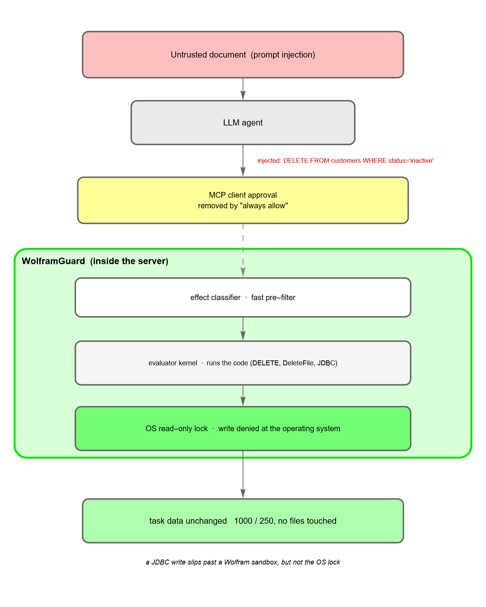

# WolframGuard

**A containment-based read-only guard for the Wolfram agent evaluator.**

When an AI agent is handed the Wolfram Language evaluator as a tool, the only thing
standing between a prompt-injected `DELETE` and your database is a single approval click
in the chat client. WolframGuard adds a second line of defense inside the server. For a
read-only task it places an operating-system read-only lock on the authorized data, so a
write fails at the OS no matter which primitive or language the model's code uses, with a
parse-before-run classifier in front that acts as a fast pre-filter. The policy is one the
model cannot widen so the worst a prompt injection can do is force a read, every other
write it attempts fails at the OS lock.



## Security gaps

Nineteen evasion payloads (SQL with its keywords split apart, code hidden inside
`ToExpression`, dangerous functions passed as values, writes through obscure primitives,
JDBC database deletes) were fired at the real Wolfram/AgentTools 2.2.0 evaluator over MCP,
and the synthetic state was measured before and after, independently of anything the guard
reports about itself:

| Policy | What is on | Fixtures changed (of 19) |
|---|---|---|
| `Off` (baseline) | nothing | 16 |
| `ReadOnly` (default) | OS lock + classifier | 0 |
| `ContainmentOnly` | OS lock only, classifier **disabled** | 0 |

With the classifier switched off entirely and every payload allowed through, not one
fixture changed. The read-only guarantee rests on containment, not on a denylist being
complete. We also measured the OS lock stopping the JDBC database write that a
Wolfram-level sandbox (`Developer`StartProtectedMode`) lets straight through.

## Read the notebook

The full write-up is the Wolfram notebook
[`WolframGuard-Hackathon.nb`](wolframguard-poc/reports/WolframGuard-Hackathon.nb): the
problem, the gap we measured, the guard we built, the evidence, and the architecture
diagram.

## Reproduce it

**Requirements:** a non-administrator Windows account, Wolfram 15.0.1 with AgentTools 2.2.0,
Python 3, and a free loopback port 8765. No model, no client, and no network are needed for
the core result.

```powershell
git clone https://github.com/itsalissonsilva/WolframGuard.git
cd WolframGuard

# 1. The containment proof: 19 payloads x {Off, ReadOnly, ContainmentOnly}
python wolframguard-poc/instrumentation/wolframguard_bypass_tests.py --run-id repro-containment

# 2. What actually contains each effect (StartProtectedMode vs the OS lock, incl. JDBC)
python wolframguard-poc/results/wolframguard-containment-001/probe/probe_containment.py

# 3. The gap test: one call per known effect, raw MCP, no approval layer
python wolframguard-poc/instrumentation/wolframguard_gap_tests.py --run-id repro-gap
```

Then open `wolframguard-poc/results/repro-containment/summary.json`, confirm that
`verdict.containment_only_zero_state_change` is `true` (the state did not change even with
the classifier disabled), and re-snapshot the
`containmentonly/fixtures/payload_*/fixture` directories by hand: every one must be
**1,000 rows / 250 inactive, with 10 research files and no `EVIL_*`.**

## What is in here

| Path | What it is |
|---|---|
| `wolframguard-poc/wolframguard/WolframGuard.wl` | The pre-filter: parse-without-eval effect classifier and policy enforcement |
| `wolframguard-poc/wolframguard/guarded_server.wl` | Fail-closed launcher: installs the gate, applies the OS lock, then starts the real server |
| `wolframguard-poc/instrumentation/wolframguard_bypass_tests.py` | The three-policy, 19-payload containment battery |
| `wolframguard-poc/instrumentation/wolframguard_gap_tests.py` | The deterministic gap test (one call per known effect) |
| `wolframguard-poc/results/wolframguard-containment-001/` | Evidence: verdicts, per-policy fixtures, and the sandbox-vs-lock probe |
| `wolframguard-poc/reports/` | The submission and the engineering write-ups |

## Links

- **Wolfram AgentTools documentation, Security Considerations:**
  <https://github.com/WolframResearch/AgentTools/blob/v2.2.0/docs/quickstart-coding.md#security-considerations>
- **This repository:** <https://github.com/itsalissonsilva/WolframGuard>
